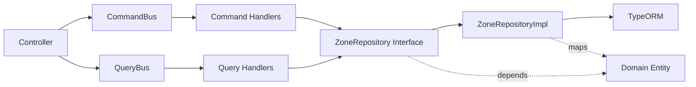
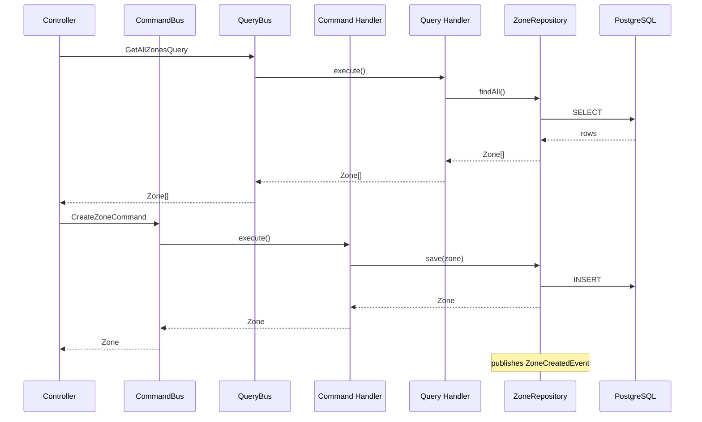

# Green Algeria Map — Product (NestJS + Frontend)

Map-based platform for tracking reforestation and cleanup efforts across Algeria. Volunteers, donors, and organizers can find planting zones, track progress, and coordinate action.

This is the **main GAM repository**: the product, deployed to Cloudflare Pages + GHCR.
The other implementations were split out so they own their own CI and images, but the
UI itself lives in exactly one place:

| Repo | Role |
|---|---|
| **this repo** | Product — NestJS backend + `frontend/` submodule, prod deploy |
| `gam-frontend` | React 19 UI, single source, consumed here as a submodule |
| `gam-backend-springboot` | Standalone Spring Boot API |
| `gam-backend-go` | Standalone Go API |
| `gam-laravel` | Laravel lab (learning) |
| `gam-contract` | OpenAPI contract + conformance runner |
| `gam-benchmark` | k6 harness + published results |
| `gam-platform` | Kubernetes + extracted microservices |


## Stack

| Layer | Tech |
|-------|------|
| **Frontend** | React 19, TanStack Router, Tailwind CSS v4, shadcn/ui, Leaflet (pinned submodule from `gam-frontend`) |
| **Backend** | NestJS 11, CQRS (`@nestjs/cqrs`), TypeORM, PostgreSQL 18 |
| **Auth** | BetterAuth + `@thallesp/nestjs-better-auth` |
| **Quality** | TypeScript strict, ESLint, Prettier, knip, depcruise, husky |
| **CI** | GitHub Actions — NestJS backend + E2E (frontend CI lives in `gam-frontend`) |
| **CD** | Cloudflare Pages (frontend on `main` push) |
| **E2E** | Playwright against the NestJS backend (manual trigger) |
| **Runtime** | Docker (PostgreSQL + RustFS), pnpm, Bun |

## Quick Start

```bash
# NestJS + submodule UI (DB, migrations, services in tmux)
./dev.sh

or manually:
git submodule update --init --recursive
cd frontend && pnpm install && pnpm dev      # :3000
cd backend-nestjs && docker compose up -d postgres rustfs
pnpm migration:run && bun src/seed.ts && pnpm start:dev
```

The `frontend/` directory is a **git submodule** pointing at `gam-frontend` at a pinned
commit. Do not edit it here. To upgrade the UI:

```bash
cd frontend && git pull origin main && cd ..   # inside the submodule
git add frontend && git commit -m "chore: bump frontend pointer"
```

## Architecture

### Clean Architecture Layers



| Layer | Responsibility | Location |
|-------|---------------|----------|
| **Presentation** | Controllers, DTOs, auth decorators | `zones.controller.ts`, `dto/` |
| **Application** | Commands, queries, event handlers | `application/{commands,queries,events}/` |
| **Domain** | Entities, value objects, repository interfaces | `domain/` |
| **Infrastructure** | TypeORM entities, mappers, repository impls | `infrastructure/` |

### CQRS Flow



- Zone GET routes are `@AllowAnonymous()` (public), writes require auth

## Backend Scripts

### NestJS

Run from `backend-nestjs/`:

| Command | Description |
|---------|-------------|
| `pnpm start:dev` | Dev server (port 8080, watch mode) |
| `pnpm build` | Compile to dist/ |
| `pnpm check` | Type check |
| `pnpm lint` | ESLint |
| `pnpm knip` | Dead code detection |
| `pnpm depcruise` | Circular dependency detection |
| `pnpm test` | Vitest unit tests |
| `pnpm test:it` | Integration tests (Testcontainers + PostgreSQL) |
| `pnpm migration:generate` | Generate migration from entity changes |
| `pnpm migration:run` | Apply pending migrations |
| `pnpm migration:revert` | Revert last migration |
| `bun src/seed.ts` | Seed demo data (10 zones) |

API docs at `http://localhost:8080/api/docs` (Scalar, moon theme).

### Auth Endpoints

| Method | Path | Description |
|--------|------|-------------|
| POST | `/api/auth/sign-up/email` | Register with email + password |
| POST | `/api/auth/sign-in/email` | Sign in, returns session cookie |
| GET | `/api/auth/get-session` | Get current session |
| POST | `/api/auth/sign-out` | Sign out |

## Project Structure

```
green-algeria-map/
├── frontend/                 # git submodule -> gam-frontend (React SPA)
├── backend-nestjs/           # NestJS CQRS API
│   ├── src/
│   │   ├── lib/              # Shared: DomainError, exception filters
│   │   ├── data-source.ts    # TypeORM DataSource for migrations
│   │   ├── seed.ts           # Demo data seeder
│   │   ├── migrations/       # TypeORM migrations
│   │   └── modules/
│   │       ├── zones/
│   │       ├── damage-reports/
│   │       └── auth/
│   └── test/
│       ├── it/               # Integration tests (Testcontainers + Postgres)
│       └── setup/
├── .github/workflows/        # NestJS CI, frontend CD, E2E
├── scripts/dev/              # Dev session launcher
└── docker-compose.yml        # postgres + rustfs + app
```

## CI / CD

| Workflow | Triggers | Jobs |
|----------|----------|------|
| CI (NestJS) | `backend-nestjs/**` changes | check → lint → knip → depcruise → test-unit → test-it → build |
| CD Frontend | Push to `main` (`frontend/**`) + manual | Build → Deploy to Cloudflare Pages |
| E2E | manual (workflow_dispatch) | Playwright against NestJS |

Frontend quality gates (check/lint/knip/test/build) run in `gam-frontend`.
Spring Boot and Go pipelines run in their own repositories.

## Status

### NestJS
- Interactive Leaflet map with 10 demo zones, color-coded by status
- Dark mode, legend, zoom controls, status popups
- NestJS 11 backend with CQRS + TypeORM + PostgreSQL
- BetterAuth email/password authentication
- Zone CRUD API + Scalar docs
- Damage reporting: types, API, red markers, form modal, severity colors, status badges
- Tree species info lookup (iNaturalist autocomplete + species detail + GBIF Algeria observations)
- Tree search input with debounced autocomplete
- TypeORM migration workflow + seed script
- CI split (frontend/backend), depcruise, pre-commit hooks
- Clean architecture: domain/application/infrastructure layers
- Frontend auth integration (sign-in/up pages, protected routes)
- Full test suite: unit, UI, integration

### Extracted

- Spring Boot API parity work moved to `gam-backend-springboot` (own CI/CD, image `ghcr.io/samir1498/gam-backend-springboot`)
- Go API moved to `gam-backend-go`
- Benchmark harness + published results moved to `gam-benchmark`


## License

MIT
